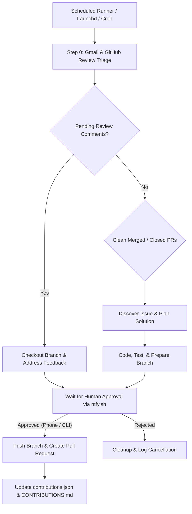

# Autonomous Open-Source Contributor

An automated workflow for discovering, triaging, and contributing to open-source repositories with review-first synchronization, Gmail integration, human-in-the-loop mobile notifications, and automated ledger management.

---

## Architecture Overview



---

## Core Capabilities

1. **Review-First Triaging**:
   - Queries Gmail via OAuth2 for GitHub review comments on previous PRs before starting new contributions.
   - Automatically prioritizes addressing maintainer feedback over opening new pull requests.

2. **Automated Ledger & Directory Management**:
   - Tracks contribution count, active PRs, and resolved issues in `contributions.json` and `CONTRIBUTIONS.md`.
   - When PRs are merged or closed upstream, purges stale local clone folders while incrementing lifetime completed counters.

3. **Human-in-the-Loop Push Notifications**:
   - Dispatches interactive action notifications to your phone via [ntfy.sh](https://ntfy.sh).
   - Allows one-tap `Accept` or `Reject` directly from your device before pushing upstream.

4. **CLI Developer Navigation**:
   - `list-pr`: View all active PRs, reviews, and contribution status.
   - `goto-pr <id>`: Instantly checkout the branch, inspect review comments, and jump to the local directory.
   - `continue-pr <id> --accept`: Approve or resume pending PR actions from the terminal.
   - `sync-pr`: Re-sync PR statuses against GitHub.

---

## Quickstart Setup

### 1. Prerequisites
- Python 3.9+
- [GitHub CLI (`gh`)](https://cli.github.com/) authenticated (`gh auth login`)
- A Google Cloud Project with the Gmail API enabled (Desktop OAuth Client ID)
- Free [ntfy](https://ntfy.sh) mobile app (iOS / Android)

### 2. Installation
Run the installer to set up the virtual environment, install dependencies, and create CLI symlinks:

```bash
git clone https://github.com/Kasa-Harendra/autonomous-oss-contributor.git
cd autonomous-oss-contributor
./install.sh
```

### 3. Environment Configuration
Copy `.env.example` to `.env` and configure your settings:

```bash
cp .env.example .env
```

Key variables:
- `CONTRIBUTIONS_DIR`: Directory where repositories and ledgers are stored.
- `NTFY_TOPIC`: Unique push notification topic name subscribed in your ntfy app.
- `GCP_CREDENTIALS_PATH`: Path to your downloaded `credentials.json` from Google Cloud.
- `GCP_TOKEN_PATH`: Path where the generated OAuth `token.json` will be saved.

### 4. Authenticate Gmail
Place your OAuth client JSON as `credentials.json` in the root folder, then run:

```bash
.venv/bin/python3 scripts/gmail_pr_checker.py --auth-only
```
Complete the browser authentication prompt once to generate `token.json`.

### 5. Running the Workflow
Run manually:
```bash
./scripts/daily_oss_contributor.sh
```

---

## Operating System Compatibility

| OS | Status | Notes |
|---|---|---|
| **macOS** | Native (Full Support) | Automatic runner via `launchd` (`templates/com.user.daily-oss-contributor.plist`). |
| **Linux (Ubuntu, Debian, Fedora, Arch)** | Native (Full Support) | Standard Bash & Python. Schedule via `cron` (`templates/crontab.example`) or `systemd --user` (`templates/daily-oss-contributor.timer`). |
| **Windows (WSL2 / Ubuntu)** | Native (Full Support) | Recommended for Windows. Run inside WSL2 bash environment. |
| **Windows (Native CMD / PowerShell)** | Partial | Core Python scripts (`scripts/*.py`) are cross-platform. Automated bash scripts (`daily_oss_contributor.sh`, `install.sh`) require WSL, Git Bash, or MSYS2. |

---

## CLI Reference

- **List tracked contributions**:
  ```bash
  list-pr
  ```
- **Inspect the latest PR**:
  ```bash
  list-pr --latest
  ```
- **Navigate and checkout a PR**:
  ```bash
  goto-pr 1
  ```
- **Approve pending contribution from CLI**:
  ```bash
  continue-pr --accept
  ```

---

## License
MIT License.
